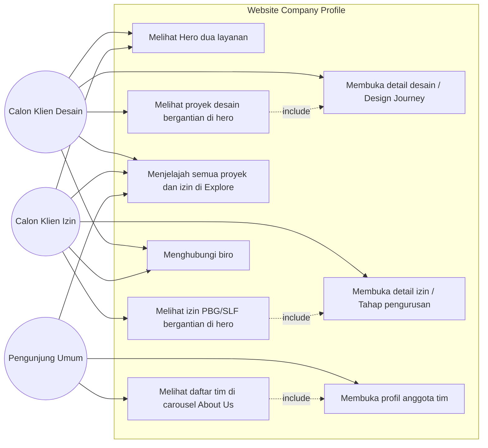

# PRD: Website Company Profile Arsitek (Desain + Jasa Pengurusan Izin)

Versi 1.0 | Dokumen ini adalah sumber kebenaran tunggal (single source of truth) untuk AI coding agent.

---

## 1. Ringkasan Produk

Website company profile untuk biro arsitek yang menawarkan **dua jenis jasa**:

1. **Desain** (portofolio proyek rumah/bangunan)
2. **Jasa Pengurusan Izin** (PBG dan SLF)

Karakter desain: **simple, modern, minimalis**. Tujuan utama website: membuat calon klien memahami dua layanan sekaligus sejak layar pertama, melihat bukti karya, mengenal tim, lalu menghubungi biro.

### 1.1 Tujuan
- Menampilkan dua layanan secara setara dalam satu hero.
- Memberi bukti kerja lewat portofolio desain dan portofolio pengurusan izin.
- Menjelaskan proses kerja (design journey dan alur izin) secara transparan.
- Memperkenalkan tim beserta latar belakang dan jobdesk.

### 1.2 Di Luar Lingkup (v1)
- Login/admin panel (konten dikelola lewat file data statis).
- Pembayaran, booking online, dan blog.

### 1.3 Asumsi (konfirmasi ke klien jika berbeda)
- "Detail page" adalah **halaman terpisah (route)**, bukan section inline.
- Profil tim (About Us) **mengembang (expand) inline** ke bawah di halaman yang sama.
- Nama perusahaan: **Grahita Design** (jadikan konfigurasi, mudah diganti). Logo ditempatkan di navbar dan footer.
- Isi konten setiap langkah izin bisa berbeda antara PBG dan SLF. Daftar tahap di bagian 6.2 adalah **draf awal bertanda (?) dari klien**, harus data-driven agar mudah diubah.

---

## 2. Persona dan Aktor

| Aktor | Deskripsi | Kebutuhan Utama |
|---|---|---|
| Calon Klien Desain | Pemilik lahan yang ingin membangun rumah/bangunan | Melihat gaya desain, proses kerja, kredibilitas |
| Calon Klien Izin | Pemilik bangunan yang butuh PBG/SLF | Memahami alur, estimasi tahapan, bukti pengalaman |
| Pengunjung Umum | Rekan, mitra, calon karyawan | Mengenal tim dan profil biro |
| Admin (offline) | Developer/pemilik yang mengedit file data | Mengubah konten tanpa mengubah komponen |

---

## 3. Sitemap dan Route

```
/                         Home (Hero + About Us)
/explore                  Explore / Project (semua desain + semua izin)
/desain/:slug             Detail Page Desain (Design Journey)
/izin/:slug               Detail Page Izin (Tahap Pengurusan, contoh: pbg, slf)
```

Navbar: **Home | Explore | About Us**
- Home: ke `/`
- Explore: ke `/explore` (nama menu boleh "Project", simpan di config)
- About Us: pada `/` scroll halus ke section About Us. Dari halaman lain, kembali ke `/#about`.

---

## 4. Flowchart Navigasi Utama

```mermaid
flowchart TD
    START([Pengunjung membuka website]) --> HOME[Home: Hero]

    HOME --> HERO_L[Hero kiri: Desain]
    HOME --> HERO_R[Hero kanan: Izin]
    HOME -->|scroll ke bawah| ABOUT[Section About Us]
    HOME -->|navbar| EXPLORE[/explore]
    HOME -->|navbar| ABOUT

    HERO_L -->|klik proyek yang sedang tampil| DD["/desain/:slug (proyek yang diklik)"]
    HERO_R -->|klik izin yang sedang tampil| DI["/izin/:slug (izin yang diklik)"]

    ABOUT --> SLIDE[Carousel 3 orang per slide]
    SLIDE -->|geser kanan/kiri| SLIDE
    SLIDE -->|klik anggota tim| EXPAND[Profil mengembang ke bawah: jabatan, background, jobdesk]
    EXPAND -->|klik lagi / klik anggota lain| SLIDE

    EXPLORE --> E_DESAIN[Grid semua proyek desain]
    EXPLORE --> E_IZIN[Grid semua izin yang diurus]
    E_DESAIN -->|klik kartu| DD
    E_IZIN -->|klik kartu| DI

    DD -->|tombol kembali / navbar| EXPLORE
    DI -->|tombol kembali / navbar| EXPLORE
    DD -->|CTA| CONTACT[Kontak WhatsApp/Email]
    DI -->|CTA| CONTACT
```

---

## 5. Use Case

### 5.1 Diagram Use Case



### 5.2 Spesifikasi Use Case

| ID | Use Case | Aktor | Prakondisi | Alur Utama | Hasil |
|---|---|---|---|---|---|
| UC1 | Melihat hero dua layanan | Semua | Membuka `/` | Hero menampilkan Desain dan Izin dalam satu layar | Pengunjung paham ada 2 jasa |
| UC2 | Melihat proyek desain di hero | Klien Desain | Di Home | Area Desain menampilkan satu proyek dan berganti otomatis; ada kontrol manual (panah/indikator) | Proyek tampil bergantian |
| UC3 | Melihat izin di hero | Klien Izin | Di Home | Area Izin menampilkan satu izin (PBG atau SLF), bergantian otomatis | Izin tampil bergantian |
| UC4 | Membuka detail desain | Klien Desain | Ada proyek tampil di hero/explore | Klik proyek, sistem membuka `/desain/:slug` milik proyek yang diklik | Detail proyek terbuka |
| UC5 | Membuka detail izin | Klien Izin | Ada izin tampil di hero/explore | Klik izin, sistem membuka `/izin/:slug` milik izin yang diklik | Detail izin terbuka |
| UC6 | Menjelajah Explore | Semua | - | Buka `/explore`, lihat semua proyek di atas dan semua izin di bawah | Semua karya terlihat |
| UC7 | Melihat tim | Pengunjung | Di section About Us | Carousel menampilkan 3 orang per slide, geser untuk melihat sisanya | Seluruh tim terlihat |
| UC8 | Membuka profil tim | Pengunjung | Carousel tampil | Klik anggota, panel mengembang ke bawah berisi jabatan, background, jobdesk | Profil terbaca |
| UC9 | Menghubungi biro | Klien | - | Klik CTA di detail page/footer, buka WhatsApp/email | Kontak terbuka |

**Aturan penting UC4 dan UC5:** tautan harus mengikuti item yang **sedang tampil saat diklik**. Jika Proyek B sedang tampil lalu diklik, tujuannya `/desain/proyek-b`, bukan proyek lain.

---

## 6. Spesifikasi Halaman dan Flow Tiap Menu

### 6.1 Home (`/`)

#### A. Hero (referensi DDAP Architect, dipecah menjadi dua panel)

**Referensi visual (ddaparchitect.com):** foto proyek tampil penuh (full-bleed), judul proyek besar dengan huruf kapital dan letter-spacing lebar di tengah, garis putih pendek di bawah judul, subjudul kategori dalam huruf kapital tipis, tautan teks "SEE MORE", serta panah prev/next bulat di sisi layar. Gaya ini dipakai pada **masing-masing panel**, dengan satu perbedaan utama: layar dibagi dua sesuai brief (Desain dan Pengurusan Izin).

**Varian 1 (default): split kiri-kanan, tinggi penuh layar (100svh)**
```
+------------------------------+------------------------------+
| DESAIN                       | PENGURUSAN IZIN              |
| (label kecil, kapital)       | (label kecil, kapital)       |
|                              |                              |
|   foto proyek full-bleed     |   foto bangunan full-bleed   |
|                              |                              |
|        HORIZON               |            PBG               |
|        ______                |            ______            |
|   SINGLE RESIDENTIAL         |   PERSETUJUAN BANGUNAN GEDUNG|
|      LIHAT DETAIL            |        LIHAT ALUR            |
|                              |                              |
|  <   o  o  o  o  o   >       |      <    o   o    >         |
+------------------------------+------------------------------+
```
- Kiri: portofolio desain (Project 1..N bergantian). Kanan: portofolio/langkah pengurusan izin (PBG dan SLF bergantian, tiap izin punya foto cover bangunan yang izinnya pernah diurus).
- Kedua panel dipisah garis putih tipis 1 px. Setiap panel punya **carousel sendiri** (rotasi, panah, indikator) yang tidak saling memengaruhi.
- Overlay gradien hitam tipis di atas foto agar teks putih terbaca. Teks hero selalu putih di atas foto.
- Navbar mengambang (gaya pill, lihat bagian 8) berada di atas kedua panel, di tengah atas layar.
- Desktop: saat kursor berada di satu panel, panel itu melebar halus (sekitar 54 persen berbanding 46 persen). Efek ini opsional dan nonaktif pada layar sentuh.
- Mobile: panel ditumpuk vertikal, Desain di atas dan Izin di bawah, masing-masing 50svh. Panah disembunyikan, diganti swipe dan indikator titik.

**Varian 2: tumpuk atas-bawah** (Desain di atas, Izin di bawah, lebar penuh, masing-masing 50svh). Perilaku data dan navigasi sama.

**Perilaku hero:**
| Elemen | Perilaku |
|---|---|
| Rotasi otomatis | Tiap 6 detik per panel (dengan jeda berbeda 1 detik agar tidak berganti bersamaan). Berhenti saat hover/fokus. Transisi crossfade 600 ms |
| Panah dan indikator | Panah bulat abu-abu transparan di kiri-kanan tiap panel, indikator titik di bawah |
| Klik area panel atau tautan "SEE MORE" | Panel Desain membuka `/desain/:slug` milik proyek yang **sedang tampil**; panel Izin membuka `/izin/:slug` milik izin yang **sedang tampil** |
| Klik panah atau indikator | Hanya mengganti slide, tidak menavigasi |
| Aksesibilitas | Tautan bisa difokus keyboard, panah punya label ARIA, `prefers-reduced-motion` mematikan rotasi otomatis |

#### B. About Us (di bawah hero, id `about`)

- Carousel horizontal, **3 anggota per slide** (desktop). Tablet: 2. Mobile: 1.
- Total 7 anggota, jadi slide 1 (3 orang), slide 2 (3 orang), slide 3 (1 orang). Geser dengan panah kiri/kanan, swipe, atau drag.
- Setiap kartu: foto, nama, posisi.
- **Klik kartu:** panel detail **mengembang ke bawah** (animasi tinggi halus) di bawah carousel, berisi:
  - Nama dan posisi
  - Background: Education, Career
  - Jobdesk (daftar)
- Hanya satu panel terbuka pada satu waktu. Klik kartu yang sama menutup panel. Kartu aktif diberi penanda (garis/outline hitam).
- Panel tertutup saat Escape ditekan.

**Daftar tim (konten dari klien):**
1. MDP
2. Dwi Kusuma
3. Yoga Pratama
4. Andika Satya
5. Doddy Indradi
6. Diah Sedani
7. Mevanie Subakti

Masing-masing: posisi + Background (Education, Career, Jobdesk). Isi detail dikirim klien; gunakan placeholder sampai tersedia.

### 6.2 Detail Page Desain (`/desain/:slug`)

Struktur:
1. Foto preview besar (hero detail) + nama proyek
2. **Design Journey** (5 tahap berurutan, tampil sebagai timeline kartu mengembang sesuai bagian 8.4):
   1. Data Collection
   2. Site Analyze
   3. Schematic Design
   4. Design Development
   5. Construction Drawing
3. Tiap tahap: judul, penjelasan singkat, galeri gambar opsional
4. Navigasi proyek sebelumnya/berikutnya, tombol kembali ke Explore
5. CTA kontak

Proyek (dari klien): **MW House, Y House, Graha Gungwah, Kanaya Florist, ACK Udayana**.

### 6.3 Detail Page Izin (`/izin/:slug`)

Struktur:
1. Judul izin (PBG / SLF) + penjelasan singkat apa itu izin tersebut
2. **Alur proses pengurusan** (timeline kartu mengembang sesuai bagian 8.4) menjelaskan alur proses izin tersebut. Draf tahap dari klien (tanda tanya, harus dikonfirmasi):
   1. Pengumpulan Data
   2. KKPR
   3. Survey
   4. Gambar
   5. Sidang
   6. Revisi
   7. Terbit
3. Tiap tahap: judul, penjelasan, estimasi waktu (opsional), dokumen yang dibutuhkan (opsional)
4. Contoh pengalaman: daftar kasus yang pernah diurus (PBG 1-3 atau SLF 1-3)
5. Tombol kembali ke Explore, CTA kontak

Izin (dari klien): **PBG** dan **SLF**. Detail setiap izin memiliki daftar tahap sendiri di file data, jadi PBG dan SLF bisa berbeda.

### 6.4 Explore (`/explore`)

Halaman daftar lengkap (nama menu bisa "Project" atau "Explore").
1. Judul halaman
2. **Section Desain:** grid semua proyek (5 proyek). Kartu: foto, nama. Klik ke `/desain/:slug`.
3. **Section Izin** (di bawah desain): grid semua izin yang diurus (PBG 1-3, SLF 1-3). Kartu: judul, jenis izin, ringkasan. Klik ke `/izin/:slug` sesuai jenis izin.
4. Opsional: filter jenis (Semua | PBG | SLF).

### 6.5 Footer (semua halaman)
Logo, nama perusahaan, alamat, kontak (WhatsApp, email), tautan navigasi.

---

## 7. Model Data (file statis di `src/data/`)

```ts
type StepDetail = {
  step: string;            // "Data Collection", "KKPR", dst
  duration?: string;       // chip estimasi waktu
  description: string;
  deliverables?: string[]; // "Deliverable dan Dokumen Keluaran"
  clientNeeds?: string[];  // "Yang Dibutuhkan dari Klien"
  images?: string[];
};

type Project = {
  slug: string;            // "mw-house"
  name: string;            // "MW House"
  cover: string;           // path gambar
  summary: string;
  category?: string;       // contoh: "Single Residential", tampil sebagai subjudul hero
  journey: StepDetail[];
};

type Permit = {
  slug: string;            // "pbg" | "slf"
  name: string;            // "PBG"
  fullName: string;        // nama lengkap izin, tampil sebagai subjudul hero
  summary: string;
  cover: string;
  steps: StepDetail[];
  cases: { title: string; summary: string; image?: string }[];   // PBG 1-3 / SLF 1-3
};

type TeamMember = {
  id: string;
  name: string;
  position: string;
  photo: string;
  education: string[];
  career: string[];
  jobdesk: string[];
};
```

Seluruh teks, gambar, dan daftar di UI **harus berasal dari file data ini**, tidak ditulis keras (hardcode) di komponen.

---

## 8. Desain dan UX

### 8.1 Prinsip
Simple, modern, banyak ruang kosong, tipografi besar, foto sebagai satu-satunya sumber warna. **Seluruh antarmuka hanya memakai hitam, putih, dan abu-abu, dengan putih sebagai warna utama.** Tidak ada biru atau warna jenuh lain.

### 8.2 Token Warna
| Token | Nilai | Pemakaian |
|---|---|---|
| `--bg` | `#FFFFFF` | Latar halaman (warna utama) |
| `--surface` | `#F7F7F7` | Latar kartu/panel sekunder |
| `--border` | `#E5E5E5` | Garis kartu dan pemisah |
| `--muted` | `#737373` | Teks sekunder, deskripsi |
| `--ink` | `#0A0A0A` | Teks utama, tombol utama, state aktif |
| `--nav` | `#404040` (opacity 85 persen, blur) | Latar navbar pill |
| `--on-photo` | `#FFFFFF` | Teks di atas foto hero |

### 8.3 Tipografi
- Century Gothic untuk seluruh teks (fallback: `"Century Gothic", "Questrial", sans-serif`).
- Judul section: ukuran besar, semi-bold, dua baris dengan **baris kedua berwarna abu tua** (efek dua nada, seperti "5 Langkah Terstruktur dari / Konsultasi hingga Serah Terima").
- Eyebrow di atas judul: huruf kapital kecil dengan letter-spacing lebar, warna abu, **tanpa titik atau strip dekoratif di depannya**.
- Judul hero: kapital, ukuran sangat besar, letter-spacing lebar, weight tipis sampai regular (mengikuti referensi DDAP).

### 8.4 Komponen Utama (mengikuti gaya build localhost)
- **Navbar:** pill mengambang di tengah atas, sudut membulat penuh, latar abu gelap semi-transparan dengan blur, teks putih. Logo dan nama perusahaan di kiri, menu di tengah (Home, Explore, About Us), tombol putih "Konsultasi" di kanan. Menu aktif ditandai pill abu yang lebih terang.
- **Kartu:** putih, border 1 px `--border`, radius 24 px, bayangan sangat halus. Foto di dalam kartu memakai radius 16 px.
- **Chip filter (Explore):** aktif hitam dengan teks putih, tidak aktif putih dengan border abu.
- **Tombol:** utama hitam teks putih (pill), sekunder putih border abu. Ikon tombol hanya garis tipis (line icon).
- **Kartu mengembang (expandable card):** tombol bulat berisi chevron di kanan ("Detail Tahap" saat tertutup, "Tutup" saat terbuka; tombol hitam saat terbuka). Dipakai pada langkah timeline dan panel profil tim.
- **Timeline:** garis vertikal abu, lingkaran bernomor di kiri. Lingkaran aktif hitam dengan angka putih, lainnya putih dengan outline abu. Tiap langkah berupa kartu mengembang yang memuat: label "TAHAP 01", chip estimasi waktu, judul, deskripsi singkat; saat dibuka muncul penjelasan dan dua kotak abu: **"Deliverable dan Dokumen Keluaran"** (daftar centang) dan **"Yang Dibutuhkan dari Klien"** (daftar titik). Hanya satu langkah terbuka pada satu waktu.
- **Indikator progres tahap:** kartu kecil di kanan atas judul timeline berisi "Tahap aktif, Langkah 01 / 05", bar progres hitam, dan nomor langkah yang bisa diklik.
- **Footer:** latar putih, garis atas abu, teks abu tua.

### 8.5 Gerak dan Responsif
- Animasi halus, 200-400 ms, easing lembut. Hormati `prefers-reduced-motion`.
- Mobile-first, breakpoint 640 / 768 / 1024 / 1280.
- Hindari tampilan "buatan AI": kurangi ikon dekoratif dan emoji, jangan awali judul dengan bullet atau strip, biarkan foto dan tipografi yang bekerja.
- Logo perusahaan dipasang di navbar dan footer.

---

## 9. Spesifikasi Teknis

- Framework: **React + Vite + TypeScript**
- Styling: Tailwind CSS
- Routing: React Router (`/`, `/explore`, `/desain/:slug`, `/izin/:slug`), scroll ke atas saat pindah route
- Carousel: Embla Carousel (hero dan About Us), swipe/drag support
- Animasi: Framer Motion (expand panel, transisi halaman)
- Gambar: `loading="lazy"`, format WebP, rasio konsisten
- SEO: title dan meta description per route, Open Graph dasar
- Aksesibilitas: semantik HTML, label ARIA untuk carousel dan panel expand, fokus terlihat, kontras cukup
- Performa: target Lighthouse 90+ (Performance, Accessibility, SEO)

### Struktur Folder
```
src/
  components/
    layout/ (Navbar, Footer)
    hero/ (Hero, HeroPanel, HeroCarousel)
    about/ (TeamCarousel, TeamCard, TeamDetailPanel)
    detail/ (Timeline, DetailHeader)
    explore/ (ProjectGrid, PermitGrid)
  pages/ (Home, Explore, ProjectDetail, PermitDetail, NotFound)
  data/ (projects.ts, permits.ts, team.ts, site.ts)
  assets/
  App.tsx, main.tsx
```

---

## 10. Kriteria Penerimaan (Acceptance Criteria)

1. Hero bergaya DDAP (foto full-bleed, judul kapital besar, garis pendek, subjudul, "SEE MORE", panah) dibagi dua panel: Desain (kiri) dan Izin (kanan) dalam satu layar pada desktop, ditumpuk pada mobile; tiap panel punya carousel sendiri.
2. Klik panel Desain membuka detail proyek yang **sedang tampil**; klik panel Izin membuka detail izin yang **sedang tampil**.
3. About Us menampilkan 3 kartu per slide di desktop dan bisa digeser untuk melihat semua 7 anggota.
4. Klik anggota membuat panel mengembang di bawah dengan jabatan, background (education, career), dan jobdesk; hanya satu panel terbuka.
5. `/explore` menampilkan semua proyek, lalu semua izin di bawahnya, dan tiap kartu mengarah ke detail yang tepat.
6. Detail desain menampilkan 5 tahap Design Journey; detail izin menampilkan alur tahap sesuai data.
7. Semua konten berasal dari `src/data`, mengganti data tidak memerlukan perubahan komponen.
8. Tampilan responsif dan tidak ada scroll horizontal pada 360 px.
9. Font Century Gothic dan palet hitam, putih, abu-abu (putih sebagai warna utama) diterapkan di seluruh UI; tidak ada warna lain selain pada foto.
10. Timeline memakai kartu mengembang dengan kotak Deliverable dan Yang Dibutuhkan dari Klien, hanya satu langkah terbuka.
11. Build berhasil tanpa error TypeScript dan tanpa error console.

---

## 11. Hal yang Perlu Dikonfirmasi ke Klien

- Varian hero final (Varian 1 split kiri-kanan atau Varian 2 tumpuk).
- Foto cover untuk panel Izin (foto bangunan yang izinnya pernah diurus).
- Isi "Deliverable" dan "Yang Dibutuhkan dari Klien" untuk tiap tahap desain dan izin (boleh dikosongkan, kotaknya otomatis disembunyikan).
- Apakah tahap izin (Pengumpulan Data sampai Terbit) sama untuk PBG dan SLF.
- Nama menu: "Explore" atau "Project".
- Foto, posisi, education, career, dan jobdesk 7 anggota tim.
- Foto dan narasi tiap proyek dan setiap tahap Design Journey.
- Kontak (WhatsApp, email, alamat) dan logo final.
